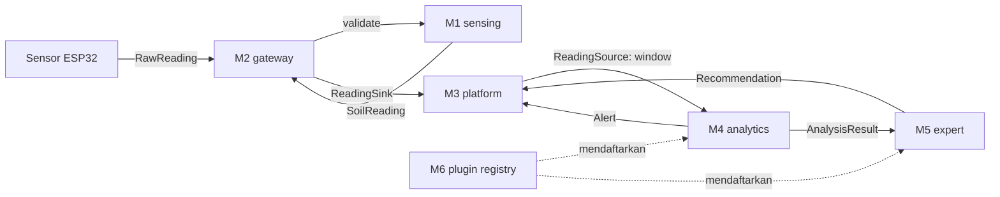

# Arsitektur

Pendekatan: **modular monolith**. Satu proses (`soil_server`), tiap modul adalah crate terpisah,
semuanya berbicara lewat trait di `soil_contracts`.

## Mengapa begini

- Kelompok bisa bekerja paralel selama kontrak stabil.
- Tanpa overhead deployment microservices; debugging dan tes e2e dalam satu proses.
- Tetap bisa dipecah menjadi layanan terpisah nanti: pasang adapter HTTP yang mengimplementasikan trait yang sama.

## Peran orchestrator

`apps/soil_server` membuat instance tiap modul, membungkusnya dengan `Arc<dyn Trait>`, lalu
menyambungkan: gateway memakai validator M1 dan sink M3; M4 dan M5 dipasang lewat registry M6.

## Python

Hanya jika benar-benar perlu (mis. pustaka statistik tertentu). Bungkus sebagai sidecar yang
tetap mengimplementasikan trait `Analyzer`, sehingga sisi Rust tidak berubah.

## Keputusan yang masih terbuka

Lihat bagian "Asumsi" di [`module-contracts.md`](module-contracts.md); sepakati sebelum kontrak dibekukan.
